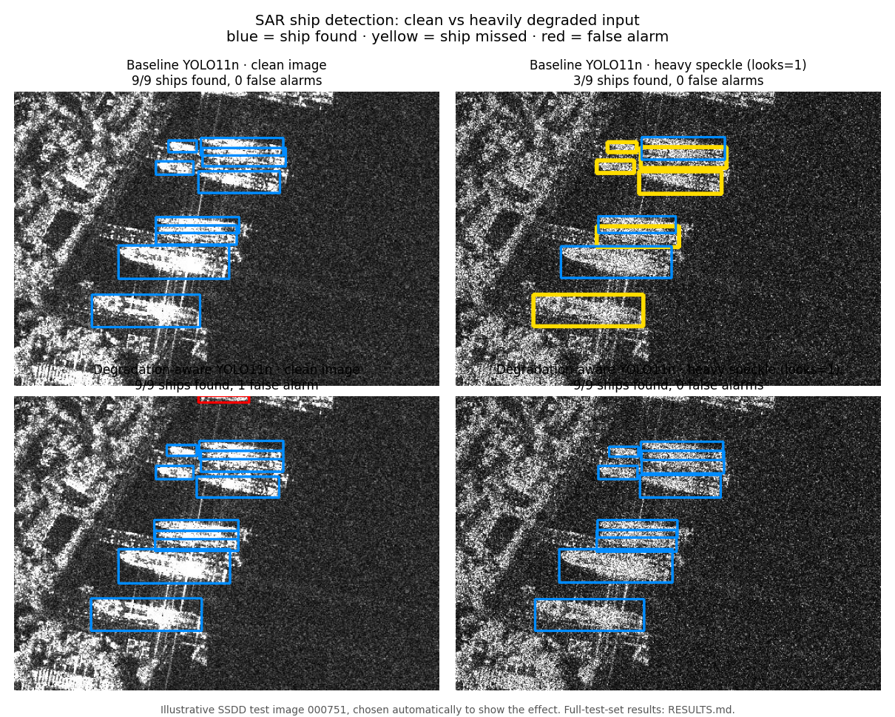
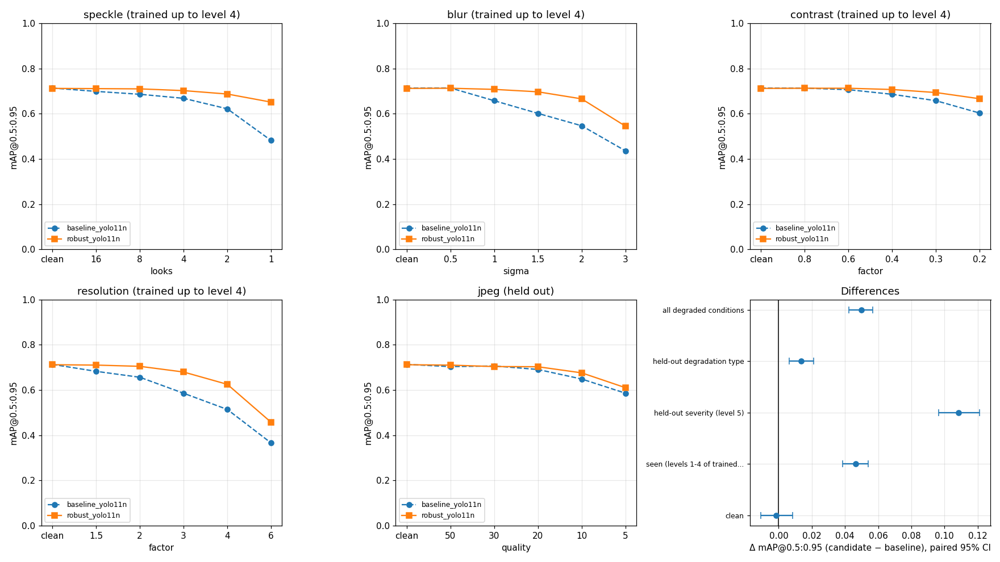
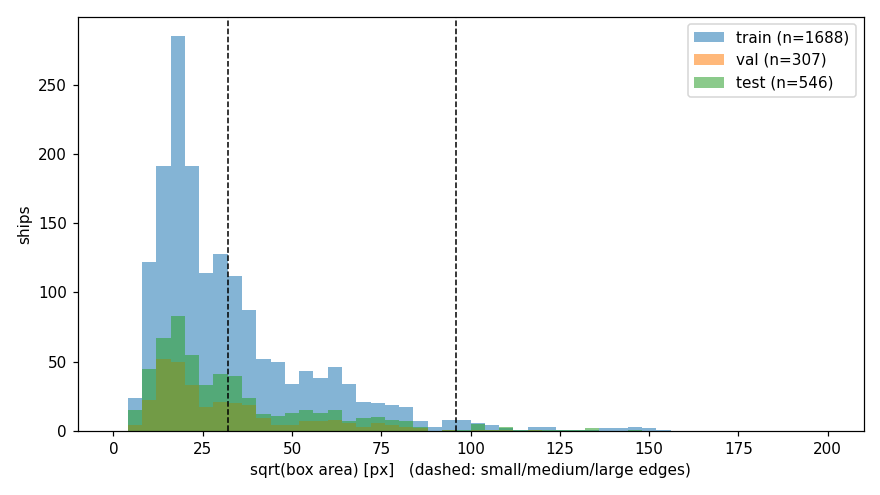
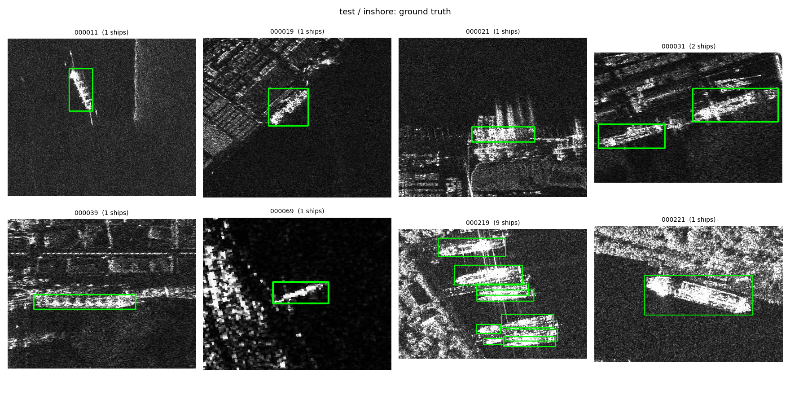
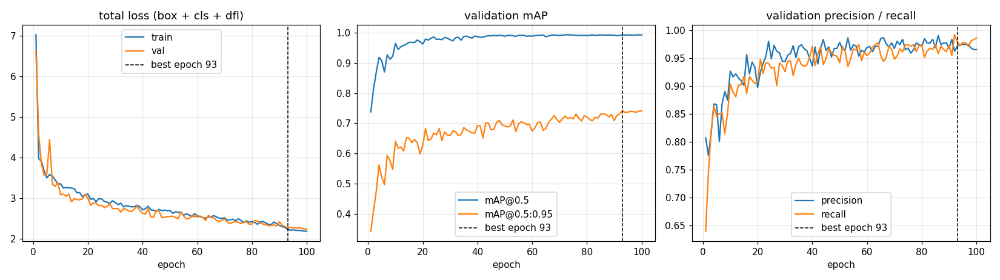
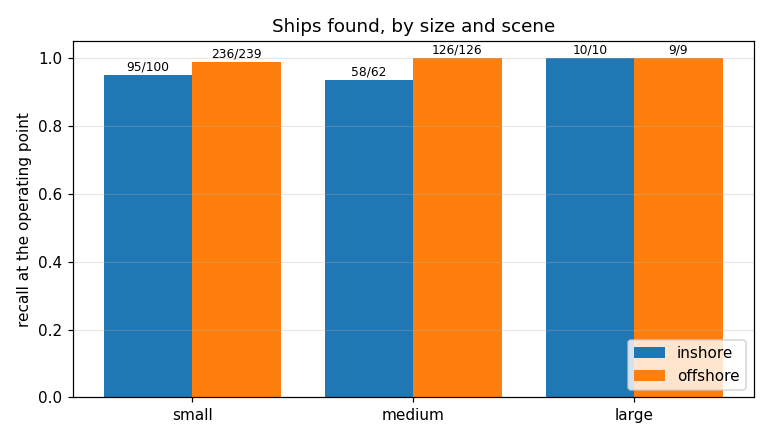
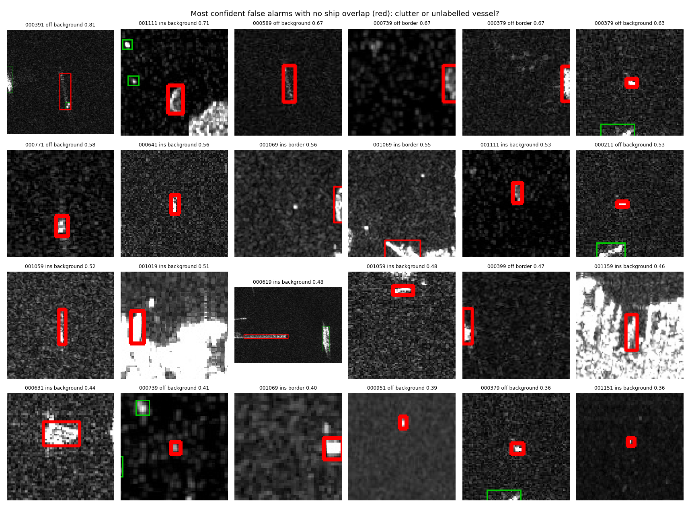
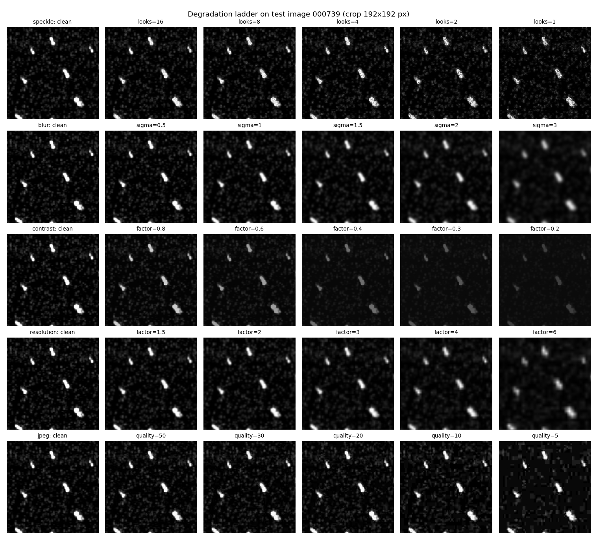
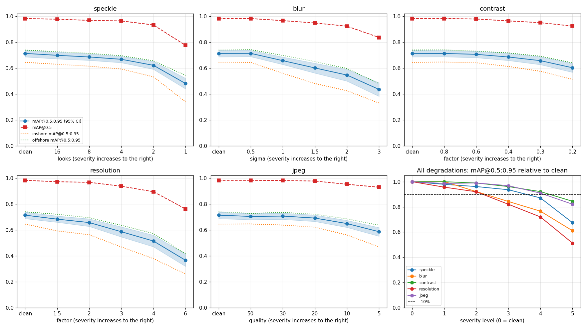
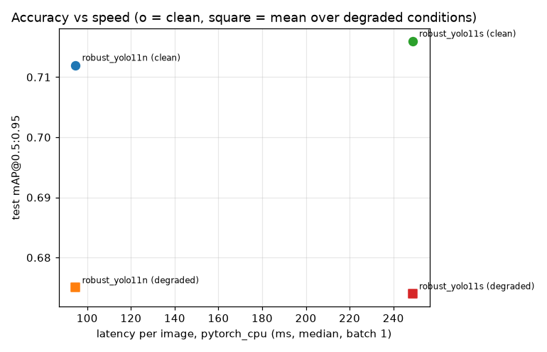

# SAR Ship Detection & Field-Robustness Study

**Problem.** Satellite radar (SAR) finds ships day and night, through cloud, including "dark"
vessels with AIS switched off. But detectors are tested on clean images, while field images
are noisier, blurrier and coarser.
**Method.** A YOLO11 detector on the SSDD dataset, stress-tested under 25 realistic degradations,
then retrained with degradation-aware augmentation; every comparison uses paired confidence
intervals and decision rules committed to git before the experiments.
**Result.** Under heavy speckle the baseline drops from 0.71 to 0.48 mAP@0.5:0.95; the
degradation-aware model keeps 0.65, gains +0.050 on average over all degraded conditions and
loses nothing on clean images. It runs at ~10 images/s on two CPU threads.

<p align="center"></p>

<!-- DEMO VIDEO: add the YouTube/LinkedIn link here once it is uploaded -->

**Key result: accuracy vs degradation severity, baseline (blue) vs degradation-aware (orange)**

<p align="center"></p>

## Quick start

```bash
git clone https://github.com/ThemistoklisSakkas/sar-ship-robustness.git
cd sar-ship-robustness
pip install -r requirements-dev.txt && pytest          # 130 unit tests, CPU only
```

Full pipeline on Google Colab: open the notebooks in `notebooks/` in order (00 → 08); see
[Reproduce](#reproduce). Every number is in [RESULTS.md](RESULTS.md); deployment notes in
[docs/DEPLOYMENT.md](docs/DEPLOYMENT.md).

## Results at a glance

| | baseline YOLO11n | **robust YOLO11n (selected)** | robust YOLO11s |
|---|---|---|---|
| clean test mAP@0.5 / mAP@0.5:0.95 | 0.982 / 0.713 | 0.982 / 0.712 | 0.984 / 0.716 |
| mean mAP@0.5:0.95 over 25 degraded test conditions | 0.625 | **0.675** | 0.674 |
| worst speckle (L=1) mAP@0.5:0.95 | 0.482 | **0.651** | 0.641 |
| parameters / CPU latency (2 threads, batch 1) | 2.6 M / 95 ms | 2.6 M / 95 ms | 9.4 M / 249 ms |

mAP values from our COCO-style evaluation on the official SSDD test set (232 images, 546 ships).

- **Robust training works:** +0.050 mAP@0.5:0.95 averaged over all degraded conditions
  (paired 95% CI [+0.042, +0.057]), clean change −0.002 [−0.011, +0.008].
- **The coast is the hard part, not ship size:** offshore recall 99.2%, inshore 94.8%.
- **Heavy speckle fails silently:** the baseline misses 38% of ships while raising *fewer*
  false alarms — an operator would see a quieter system, not a broken one.
- **A bigger model does not help** on 778 training images: YOLO11s matches YOLO11n on clean and
  degraded data, extrapolates worse to the most severe conditions, and is 2.7× slower on CPU.
- **ONNX export is exact** (test mAP identical to PyTorch to 4 decimals).

## Why this matters

SAR sees through cloud and at night, so it is a primary sensor for maritime domain awareness
and for finding "dark" vessels that switch off AIS. A detector is only usable operationally if
we know how it behaves when the input is worse than the training data: another sensor mode,
fewer looks, motion blur, a compressed datalink. This project measures that and fixes part of it.

## Data

**SSDD**, official release ([Zhang et al., 2021](https://doi.org/10.3390/rs13183690);
licence and citation in [docs/DATA_LICENSE.md](docs/DATA_LICENSE.md)): 1,160 SAR chips,
2,587 ships, horizontal boxes, official split 928 train / 232 test (46 inshore, 186 offshore).
Validation = 15% of train, stratified by inshore/offshore.

Checks that changed the data:
- **Leakage in the official split:** 12 train images are byte-identical to test images; their
  train copies were removed (the test set stays official).
- **25 pseudo-colour images** in a single-channel modality were converted to grayscale.
- 62% of test ships are smaller than 32×32 px.

<p align="center">
  
  
</p>

## Method

```
SSDD (VOC) ─► leakage + colour checks ─► YOLO format ─► train YOLO11n (COCO-pretrained)
                                                              │
     own COCO-style mAP, bootstrap CIs, error taxonomy ◄──────┤  phase 3
     5 degradations × 5 severities, robustness curves ◄───────┤  phase 4
     degradation-aware augmentation, paired comparison ◄──────┤  phase 5
     YOLO11n vs YOLO11s, ONNX export, latency ◄───────────────┘  phase 6
```

Principles: one variable changed at a time; seeds and parameters in config; hypotheses and
decision rules written before the run; paired bootstrap on the same images for every comparison.

## Baseline and error analysis

YOLO11n reaches test mAP@0.5 0.982 / mAP@0.5:0.95 0.713, 95% CI [0.685, 0.740]. Train and
val loss track each other for 100 epochs (no overfitting); a second run with the same seed
reproduced the validation metrics to three decimals.

<p align="center"></p>

Where it fails (at conf 0.25: 534 TP, 56 FP, 12 FN):
- **Inshore is clearly worse** (mAP@0.5:0.95 0.645 vs 0.739 offshore; the CIs do not overlap).
- **Only 5 of the 12 misses are a threshold problem**; the others are ships merged with a
  neighbour or boxed with the wrong extent at dense berths.
- **Small ships are found but boxed loosely** (mAP@0.5:0.95 0.677 small vs 0.774 medium).
- Several confident "false alarms" in open water look like **unlabelled vessels** or cut-off
  ships at the image border. The test labels were not edited after seeing the predictions.

<p align="center">
  
  
</p>

## Field robustness of the baseline

Each degradation has a physical meaning: speckle (fewer looks), Gaussian blur (defocus),
contrast reduction (lower target-to-clutter ratio), resolution loss (coarser sensor mode), and
JPEG (bandwidth-limited datalink).

<p align="center"></p>
<p align="center"></p>

- Worst level, mAP@0.5:0.95 vs clean: resolution 6× −49%, blur σ=3 −39%, speckle L=1 −33%,
  JPEG q=5 −18%, contrast ×0.2 −16%.
- **Localisation breaks before detection:** blur σ=1 costs 1.6% of mAP@0.5 but 7.8% of
  mAP@0.5:0.95, so length/class estimates degrade first.
- **JPEG quality ≥ 20 is safe** (−3%).

## Degradation-aware training

With p = 0.5, one random degradation (speckle, blur, contrast, resolution) up to severity
level 4 is applied to each training sample. JPEG and level 5 are held out to test generalisation.

(Curves per degradation: the key-result plot at the top of this page.)

| group (Δ mAP@0.5:0.95, robust − baseline) | paired 95% CI |
|---|---|
| clean | −0.002 [−0.011, +0.008] |
| seen severities (levels 1–4) | +0.046 [+0.039, +0.054] |
| held-out severity (level 5) | +0.108 [+0.096, +0.121] |
| held-out degradation (JPEG) | +0.014 [+0.006, +0.021] |
| **all 25 degraded conditions** | **+0.050 [+0.042, +0.057]** |

Verdict by the pre-registered rule: **better**. The honest reading:
- Recovery beyond the trained range is uneven: 74% of the speckle loss, 27% of the
  resolution loss. Noise can be learned around; lost resolution cannot be recovered.
- Transfer to an unseen degradation type is small (JPEG +0.014), which is the more cautious
  estimate of field robustness.
- At the 0.25 threshold the robust model raises more false alarms on clean images (72 vs 56),
  so the threshold must be re-tuned on validation data before use.

## Model size and deployment

<p align="center"></p>
<p align="center"><sub>CPU latency (2 threads, batch 1). The y-axis is zoomed: the vertical gaps
between the two models are inside their paired 95% CIs.</sub></p>

YOLO11s (3.6× the parameters) gains nothing measurable (clean +0.004, degraded −0.001; both
CIs include 0), is worse at the most severe level (−0.019), and is 2.7× slower on CPU, so
**robust YOLO11n is selected**. Its FP32 ONNX export reproduces the PyTorch test mAP exactly.
A Sentinel-1 IW scene (~1,000 chips of 640²) takes ~15 s on a T4 or ~100 s on 2 CPU threads.
Speed is not the constraint here; accuracy under degradation is. The TensorRT/Jetson path
(build on target, FP16/INT8 with calibration, re-validation on degraded sets) is in
[docs/DEPLOYMENT.md](docs/DEPLOYMENT.md).

## Limitations

- **One dataset, one training seed per model.** Seed-to-seed variance is not measured, so
  model-vs-model differences near 0.01 are not conclusive.
- **Scene leakage** cannot be ruled out: SSDD has no acquisition IDs, and neighbouring chips
  of one scene sit on both sides of the split. Test results are likely somewhat optimistic.
- **Label noise:** unlabelled ships and cut-off border ships count as false alarms, and the box
  convention for smeared ships varies. Measured precision is pessimistic, and mAP@0.5:0.95 has
  a ceiling below 1.
- **Synthetic degradations:** training and evaluation use the same degradation functions
  (except JPEG), applied one at a time, on 8-bit display images that already contain speckle.
  Real sensors differ (spatially correlated speckle, azimuth-only defocus, combined effects).
- **Small inshore subset** (46 images): inshore differences smaller than ~0.06 are not resolvable.
- **No empty scenes** in SSDD: false alarms on ship-free sea and land are under-tested.
- **Latency on Colab hardware only:** batch-1 GPU timings are overhead-bound and not Jetson numbers.
- **Licensing for operational use:** this repository's code is MIT, but it depends on
  [Ultralytics YOLO](https://github.com/ultralytics/ultralytics), which is licensed under
  **AGPL-3.0**. A commercial or operational product built on it must either release its own
  source under AGPL-3.0 or obtain an Ultralytics Enterprise License. The robustness methodology
  (degradation suite, paired evaluation, decision rules) is detector-agnostic and can be applied
  unchanged to a detector under a permissive licence (e.g. Apache-2.0).

## Future work

1. Cross-sensor evaluation on **HRSID** (real, not synthetic, distribution shift).
2. Several training seeds and a seed-aware paired comparison.
3. Operating-point comparison at equal recall, with each model's threshold tuned on validation.
4. Oriented boxes (RBox-SSDD) for dense berths and length estimation; a sea-land mask
   (SL-SSDD) against coastal clutter.
5. An input-quality gate (resolution, equivalent number of looks) and AIS correlation to
   estimate recall in operation.
6. TensorRT FP16/INT8 on a Jetson, re-validated with the same paired comparison.

## Reproduce

Local (CPU): unit tests only.

```bash
python -m venv .venv
.venv\Scripts\activate
pip install -r requirements-dev.txt
pytest
```

Colab, in order (each notebook is thin; the logic is in `src/sarship`):

| notebook | runtime | does |
|---|---|---|
| `00_colab_setup` | any | Drive, clone, install, tests |
| `01_data` | CPU | download SSDD, `sarship.data.prepare` (YOLO format, splits, checks, figures) |
| `02_baseline` | T4 | `sarship.train`, `sarship.evaluate` |
| `03_error_analysis` | CPU | `sarship.analysis.run` |
| `04_robustness` | CPU | `sarship.robustness` |
| `05_robust_training` | T4 | robust training, `sarship.compare` |
| `06_model_comparison` | T4 | YOLO11s, `sarship.compare`, `sarship.benchmark` |
| `07_report` | CPU | `sarship.report` (collects the README figures) |
| `08_demo` | CPU | `sarship.hero` (README hero figure) and a live clean-vs-noisy run for the demo |

Training reads a local copy of the data (Drive reads are ~100× slower); results go to Drive.
Seeds and every parameter are in `configs/default.yaml`; environment versions are in RESULTS.md.

## Repository layout

```
configs/default.yaml   all parameters (data, training, augmentation, evaluation, robustness)
src/sarship/
  data/                SSDD download/layout, VOC→YOLO, splits + leakage checks, stats, figures
  analysis/            IoU matching, COCO-style AP, bootstrap / paired bootstrap, error taxonomy
  degrade.py           the five field degradations + random training augmentation
  robust_train.py      hook into the Ultralytics trainer (survives close_mosaic and resume)
  train.py, evaluate.py, robustness.py, compare.py, benchmark.py, report.py, hero.py
notebooks/             thin Colab notebooks, one per phase
tests/                 130 pytest tests (no GPU or Ultralytics needed)
docs/                  dataset licence, deployment notes, README figures
```
